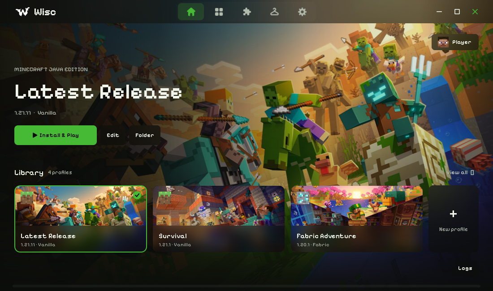

<div align="center">
  
  <h1>Wisc · Minecraft Java Edition Launcher</h1>
  <p><strong>Your worlds, your profiles, your style.</strong></p>
  <p>
    <a href="https://github.com/wisc-launcher/wisc/releases/latest"></a>
    <a href="LICENSE"></a>
    <a href="https://www.python.org/"></a>
    <a href="https://flet.dev/"></a>
  </p>
  <p>
    <a href="#features">Features</a> ·
    <a href="#download-wisc">Download</a> ·
    <a href="#run-from-source">Run from source</a> ·
    <a href="#frequently-asked-questions">FAQ</a> ·
    <a href="#contributing-and-community">Community</a>
  </p>
</div>

**Wisc** is a free, open-source **Minecraft Java Edition launcher** built with Python and [Flet](https://flet.dev/). Install vanilla releases and snapshots, create modded profiles with **Fabric, Forge, NeoForge, or Quilt**, and sync **Ely.by skins** from a Minecraft-inspired desktop interface.

## Launcher preview



<p align="center"><em>Automatically captured from the latest successful main build with example profiles. Each release includes its own screenshot in the release notes. <a href="docs/screenshots/wisc-home.png">View the bundled preview.</a></em></p>

## Features

| Feature | What you can do |
| --- | --- |
| **Minecraft versions and mod loaders** | Install and launch vanilla releases, snapshots, Fabric, Forge, NeoForge, and Quilt. Use the latest-release shortcut or pin a profile to a specific version. |
| **Profiles and instances** | Keep game folders separate, customize icons, reorder profiles, and import installations from the official Minecraft launcher or discover local instances while preserving version pins and game folders. |
| **Ely.by accounts and skins** | Sign in to Ely.by, sync your skin, rotate Classic/Steve and Slim/Alex previews, and reuse cached skins. A bundled Java skin bridge applies custom skins in-game. |
| **Java and performance settings** | Choose a Java executable, adjust RAM within detected system limits, set profile JVM arguments, and configure game resolution, fullscreen, and launcher behavior. Turn on **1K FPS Mode** to apply a tuned video preset, tuned JVM flags, and a bundled performance mod on every profile. |
| **Download progress and game logs** | Follow installation progress and download speed, cancel downloads, and inspect captured game output from the launcher. Windows launches avoid an extra Java console window. |
| **Offline play** | Launch previously installed versions, reuse cached skin previews, and browse local profiles with automatic connection detection. |
| **[Discord Rich Presence](docs/discord-presence.md)** | Show your current launcher page or the Minecraft version and mod loader you are playing, with your skin face, elapsed time, and an on/off switch in Options > Launcher. |
| **Minecraft-inspired design** | Use the original top tabs, Pixelify Sans branding, persistent version artwork, dark glass, and selectable Minecraft themes. Mods, modpacks, launcher updates, and notifications follow the selected theme. |

## Download Wisc

**[Download the latest release →](https://github.com/wisc-launcher/wisc/releases/latest)**

Windows x64 release builds support a **portable ZIP** and a **Windows installer (`*-setup.exe`)**. Extract the ZIP and run `Wisc.exe`, or run the installer. You do not need Python for the packaged build; Minecraft still needs a Java runtime appropriate for the version you want to play.

Visit [all releases and changelogs](https://github.com/wisc-launcher/wisc/releases) for earlier builds and release notes. To try the current source interface, follow the setup below.

For local packages and automated GitHub releases, see the [Windows build and release guide](docs/releasing.md).

## Run from source

### Requirements

- **Python 3.10 or newer**
- **Java** compatible with your chosen Minecraft version; common versions require Java 8, 17, or 21, and newer releases may require a newer runtime
- **Git** to clone the repository

### Clone the repository

~~~bash
git clone https://github.com/wisc-launcher/wisc.git
cd wisc
~~~

### Install dependencies and start

Use a virtual environment to keep the launcher's dependencies together. The commands below use its Python executable directly, so activation is optional.

**Windows (PowerShell)**

~~~powershell
py -3 -m venv .venv
.\.venv\Scripts\python.exe -m pip install --upgrade pip
.\.venv\Scripts\python.exe -m pip install -r requirements.txt
.\.venv\Scripts\python.exe main.py
~~~

**macOS / Linux**

~~~bash
python3 -m venv .venv
.venv/bin/python -m pip install --upgrade pip
.venv/bin/python -m pip install -r requirements.txt
.venv/bin/python main.py
~~~

### Launch your first Minecraft profile

1. Choose an **offline username** or sign in with an **Ely.by account**, the current account options.
2. Select the latest release, or open **Library → New Profile** to choose a Minecraft version and mod loader.
3. In **Options > Java**, select the appropriate Java runtime and RAM allocation.
4. Launch the profile. Keep an internet connection available for the first installation so game files, libraries, and assets can download.

Existing official launcher profiles and locally discovered instances are imported automatically.

## Frequently asked questions

### Does Wisc support Fabric, Forge, NeoForge, and Quilt?

Yes. Choose the loader and a compatible Minecraft version when creating a profile. Open the **Mods** tab to manage installed mods, discover compatible downloads, or install a modpack. You can also place compatible `.jar` files in a profile's `mods` folder through **Open Game Folder**.

### How do custom Minecraft skins work?

Sign in with an [Ely.by account](https://ely.by/), then choose a custom skin PNG or sync your Ely.by skin in the **Skins** tab. The launcher caches skins locally and includes a Java companion for applying them in-game. Offline username accounts use the default Steve/Alex skins.

### Can I play Minecraft offline?

Yes, when the selected version and its required game files are already installed and a compatible Java runtime is available. Installing new versions or mod loaders and signing in to Ely.by require an internet connection.

### Where are launcher settings, profiles, and cached skins stored?

Wisc stores its data in a `wisc` folder inside the default Minecraft directory:

| Operating system | Launcher data folder |
| --- | --- |
| Windows | `%APPDATA%\.minecraft\wisc` |
| macOS | `~/Library/Application Support/minecraft/wisc` |
| Linux | `~/.minecraft/wisc` |

Separate game instances live in the Minecraft directory's `instances` folder unless a profile uses an existing game folder. Legacy launcher data from the project's `.data` folder is migrated automatically.

Existing installations keep using their `gr8launcher` data folder so profiles,
custom artwork, skins, and mod records remain available. Saved Ely.by sessions
and CurseForge keys are read from native credential storage and moved to Wisc's
namespaces only after a verified save. To switch from an older Gr8 Launcher
build, install Wisc once using its installer, or extract the full portable ZIP.

## Project structure

```text
Wisc/
├── main.py                 # Launch entry point and updater startup guard
├── wisc/
│   ├── app.py              # Navigation, page wiring, and launch actions
│   ├── ui/                 # Flet pages, controls, dialogs, and feedback
│   ├── services/           # Minecraft, profiles, accounts, skins, and updates
│   ├── mods/               # Providers, compatibility, mod installs, modpacks
│   └── core/               # State, storage, credentials, palettes, and paths
├── .assets/                # Minecraft artwork, fonts, skins, and licenses
├── tools/                  # Build, release, screenshots, and Java skin bridge
├── packaging/              # Windows installer configuration
├── web/                    # Website source
├── api/                    # Website deployment API functions
├── docs/                   # Feature docs, code map, and release notes
├── temp/                   # Ignored local regression tests and scratch work
└── requirements.txt        # Runtime dependencies
```

See the [code map](docs/architecture.md) for individual modules, resource paths,
and focused checks. Build and release tools work without local scratch files or
reference projects.

Keep all test scripts, validation scripts, and scratch output local in the
ignored `temp/` directory. They are not included in a clone or required by the
GitHub build. If you have these local test files, run them from the project root
after installing the build dependencies:

~~~powershell
python -B -m unittest temp.test_release_plan temp.test_release_tag temp.test_publish_screenshot temp.test_ui_toasts
~~~

## Contributing and community

Bug reports, improvements, and documentation contributions are welcome. [Open an issue](https://github.com/wisc-launcher/wisc/issues) with your launcher version, operating system, Minecraft version, mod loader, and relevant logs, or [submit a pull request](https://github.com/wisc-launcher/wisc/pulls).

Join the [launcher community on Discord](https://dsc.gg/_gr8) to discuss the launcher and share feedback.

## License

Wisc is licensed under the [GNU General Public License v3.0](LICENSE).

*Not an official Minecraft product. Not approved by or associated with Mojang or Microsoft.*
